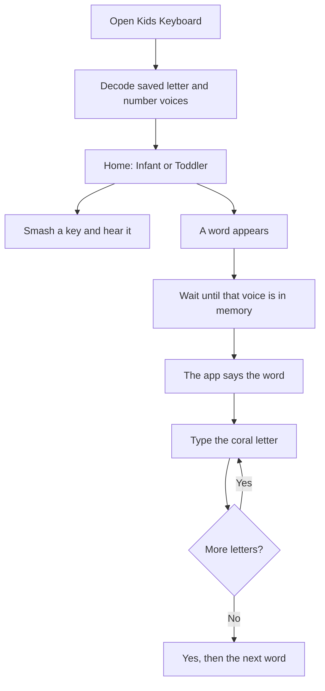

# Kids Keyboard

A fullscreen typing toy for the youngest kids. Infant mode says whatever they smash. Toddler mode shows one short word and waits for each letter, in order.

The window is the whole screen. There is no settings button to poke, and ordinary desktop shortcuts stay out of the way while a child is playing. A parent leaves with a chord that a toddler will not hit by accident.

It is a Python GTK 4 app. On this computer it is installed as **Kids Keyboard** and shows up in the Omarchy menu. The application id stays `kids.typing`, so the saved key and the voice cache keep their places.

## A session



### Opening

The first screen is black. A coral keycap and the words **Kids Keyboard** are the large part. Under them, smaller gray type says **Grok Voice** and “Loading Grok generated voice files.” A white bar moves while saved letter and number clips are decoded into memory.

Keys do not skip this page. The parent chord still works, and a finished load does not cover settings if a parent already opened them.

Each launch also picks one slogan for the home screen:

- Just your type of fun.
- The keys to the alphabet.
- Every letter counts.
- Mind your Ps and Qs.
- All the write keys.
- A capital idea.
- Caps off to you.
- From A to Z, key by key.

### Infant mode

One big key. Any letter or number the child hits is shown on that key, and the app says it.

The name under the key is the teaching word: “ay”, “bee”, “zee”, “zero”. The voice says the letter itself. **A** is the letter A, not the word “ay”. **Z** is sent to the voice as “zee”, because the voice would otherwise say “zed”. Numbers are spoken as the digits `0` through `9`.

If a Grok clip for that letter is missing, infant mode falls back to espeak-ng, the robot voice. Fast key smashes overlap, so a run of letters is still heard instead of each one cutting off the last.

**Modes** in the corner returns home.

### Toddler mode

The lesson is one word at a time, drawn from forty short words and shuffled each visit:

`cat` `dog` `sun` `mom` `dad` `bus` `hat` `pig` `cup` `red` `bed` `box` `fox` `hen` `jam` `kid` `log` `map` `nut` `pen` `rat` `top` `cow` `bee` `egg` `ball` `duck` `fish` `frog` `milk` `book` `star` `tree` `bird` `cake` `door` `hand` `home` `moon` `shoe`

The app picks **one voice for that word**. It will not start until that voice can say all of these from real Grok audio, already decoded in memory:

- the word itself
- each letter in it (Z as “zee”)
- the finished line, such as `T, cat`

While those clips are still loading, the letters look dim and a warm bar sits under the word. Typing, Space, and Escape do nothing. The parent chord still works. If a download fails, the bar stays and the app retries in the background. Toddler mode never uses the robot voice.

When the clips are ready, the app says the word. The prompt says **Listen**, and keys pressed during that announcement are ignored, including a key that is still held when the announcement ends.

Then the prompt says **Your turn**.

- The next letter is a coral key.
- Letters already typed are green.
- Letters still to come are white.
- Only the next letter counts. A wrong key is ignored.
- Each correct letter is spoken in the **same voice** that said the word. Those letter sounds may overlap.

The last letter plays the finished line (`T, cat`, with a comma, so it does not sound like “a cat”). The prompt says **Yes!** About a second and a half later the next word appears, and the clips for the finished word are dropped from memory. The files on disk stay.

**Modes** returns home and drops that word’s decoded clips too.

#### Space

A press of Space, when it is the child’s turn, picks a new voice and says the word on the screen again. Typed letters after that use the new voice. The loading bar does **not** appear for a replay. The app still waits until the new voice is in memory before it speaks, and typing stays locked until that replay finishes.

Letting go of Space does not say the word a second time.

Space does none of this when it is the next step of the parent chord, while a word is already being spoken, or while the first-load bar is already on screen.

#### The hint

Hold Space for one second. A quiet laptop keyboard appears under the word.

- Letters and numbers are labeled.
- Shift, Return, the space bar, punctuation, and the other keys are blank shapes, so the picture still reads as a whole keyboard.
- The key the child should press next is the same solid coral key as the letter in the word.
- Every other key is faint.

Releasing Space hides the hint. If the child types the correct letter while Space is still held, the coral key moves to the next letter. When the word is finished, the hint goes away.

## Parents

There is no settings button. The way out is the same chord that opens settings.

Hold these keys in order, and do not let go of a key once it is down:

1. Shift
2. Ctrl
3. Command (the Super key)
4. Space
5. Return

When the fifth key goes down, a ring in the corner starts filling clockwise.

- Let go, and settings opens.
- Keep holding all five for two seconds, and the app quits.

The corner line reads `Shift + Ctrl + Command + Space + Return, hold 2 seconds`. While the ring is filling it also says to release for settings or keep holding to exit.

Escape, or **Home**, leaves settings. On the black loading page, Escape does not leave. The chord still does.

### The voice key

Toddler speech and the Grok letter clips come from the xAI text-to-speech API. One key is enough.

Settings asks for that key and stores it in the login keyring, under the schema `kids.typing.XaiApiKey`. The field is hidden as a password. Saving an empty field clears the saved key.

When settings opens, it fills the box from the first place it finds a key:

1. `XAI_API_KEY` in the process environment
2. an `XAI_API_KEY=` line in `~/.bashrc` (it does not need to be exported)
3. the key already in the keyring

The running app looks in the other order: keyring, then the environment, then `~/.bashrc`. A key typed into settings is what the app uses after you save it. Playing clips that are already on disk does not need the key.

The key is billed on the xAI team that created it. A spending limit on that team stops new downloads. The app says so once, keeps the toddler bar up, and retries. It does not switch that word to the robot voice.

## How the sound works

Speech is requested from `https://api.x.ai/v1/tts` and saved as mp3 under:

`~/.local/share/kids-typing/voices/<voice>/<phrase>-<hash>.mp3`

Those files are a cache on the machine that generated them. They are not part of this repository.

There are 28 Grok voices. Each launch picks 10 at random and decodes their saved letter and number clips before the home screen appears. Set `KIDS_TYPING_VOICE` to one voice id, such as `eve`, to use only that voice. The default voice, when a single name is needed, is `eve`.

Toddler words are not part of that startup set. A word is fetched for the one voice chosen for it, when the child reaches that word.

Playback does not start a new player per key. ffmpeg turns a clip into mono 48 kHz PCM, and one PipeWire stream (`pw-cat`) plays a mix. A second letter does not quiet the first. The mix stays only a few dozen milliseconds ahead of the speakers, so a fast smash is heard quickly and does not burst out later as a pile of delayed audio.

The screen does not sleep while the window is open, and keyboard shortcuts are inhibited so a child’s typing is not also a desktop shortcut.

## Run it

On Omarchy, install the pieces the app shells out to and imports:

```bash
sudo pacman -S python python-gobject python-cairo gtk4 ffmpeg espeak-ng pipewire libsecret
```

From this directory:

```bash
python3 kids_typing.py
```

This computer already has a menu launcher. `~/.local/bin/kids-typing` runs the app, and `~/.local/share/applications/kids-typing.desktop` names it Kids Keyboard. The icon is `kids-typing`.

From a fresh clone, `packaging/kids-typing` launches `kids_typing.py` in the repository root. The desktop entry in `packaging/kids-typing.desktop` calls a `kids-typing` command on `PATH`. Point that command at `python3 /path/to/kids_typing.py`. Install the icon with:

```bash
install -Dm644 icons/hicolor/scalable/apps/kids-typing.svg \
  ~/.local/share/icons/hicolor/scalable/apps/kids-typing.svg
gtk4-update-icon-cache -f ~/.local/share/icons/hicolor
```

## The code

| File | What it does |
| --- | --- |
| `kids_typing.py` | The window: modes, the loading page, toddler keys, the hint keyboard, and key handling |
| `kids_logic.py` | The word list, what text a letter should speak, and the parent chord |
| `kids_voice.py` | The voice roster, the xAI download, the mp3 cache, and the keyring |
| `kids_mix.py` | Decode, mix, and the one playback stream. Also the rule that a toddler word is not spoken until every required clip is in memory |
| `kids_ring.py` | The donut that fills while the exit chord is held |
| `test_kids_*.py` | Tests for those pieces |

Tests that do not take over the screen:

```bash
python3 test_kids_logic.py
python3 test_kids_mix.py
python3 test_kids_voice.py
python3 test_kids_ring.py
python3 test_kids_window.py --toddler
python3 test_kids_window.py --settings
```

`python3 test_kids_window.py` with no flag presents the real window, exercises both modes, and closes itself. `--loading` checks the startup page. The snapshot it takes depends on the GTK renderer and can come back empty on this compositor, so it is a poor pass/fail gate.

## License

A license has not been chosen yet. Until one is added, this code is not offered for reuse.
